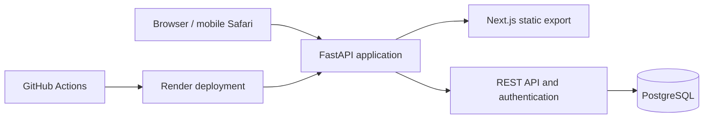

# Athletica Log

Athletica Log is a production-deployed workout logger for recording strength
training quickly, reviewing past performance, and preparing the next session.
It is also a compact reference project for building and operating a full-stack
web product beyond the prototype stage.

**Live application:** [athletica.emminger-net.de](https://athletica.emminger-net.de)

Access is invitation-only because the production instance contains private
training data. A dedicated reviewer account can be provided on request.

## What the product can do

- Record workouts with exercises, sets, weight, repetitions, and optional RPE.
- Prefill the most recent performance when an exercise is selected.
- Browse set details and calculated training load in the workout history.
- Duplicate a past workout into an editable session dated today.
- Edit and delete workouts without changing the source workout when duplicating.
- Switch the interface between German and English.
- Use the responsive interface on desktop and mobile devices.
- Keep exercises and workout data isolated per user.
- Manage invite-only tester accounts, password changes, one-time password resets,
  account deactivation, and invitation revocation.

## Architecture



The production image contains both the statically exported Next.js frontend and
the FastAPI backend. Serving them from one origin keeps deployment and cookie
security straightforward. PostgreSQL runs as a private managed database. Alembic
migrations run before each production deployment.

## Technology

| Area | Stack |
| --- | --- |
| Frontend | Next.js, React, TypeScript |
| Backend | FastAPI, Python, SQLAlchemy, Alembic |
| Database | PostgreSQL |
| Local development | Docker Compose |
| Production | Docker, Render, custom domain, managed TLS |
| Quality | Pytest, Vitest, Ruff, ESLint, TypeScript |
| Delivery | GitHub Actions with gated Render auto-deploys |

## Engineering highlights

- Session and one-time tokens are stored as hashes; passwords use `scrypt`.
- Authorization is enforced server-side and all user-owned queries are scoped to
  the authenticated user.
- Production enables secure cookies and HSTS, disables API documentation, and
  keeps the database off the public network.
- Liveness and readiness endpoints, release identifiers, request IDs, structured
  request logging, and deployment smoke tests support production diagnostics.
- CI builds and tests both the development stack and the actual production image
  before Render can deploy `main`.
- Operational, recovery, deployment, and release procedures are documented in the
  repository.

## Run locally

Docker Desktop is the only local prerequisite.

```powershell
Copy-Item .env.example .env
docker compose up --build
```

The local environment starts with authentication disabled and preserves its data
in named Docker volumes.

- Application: [http://localhost:3000](http://localhost:3000)
- API documentation: [http://localhost:8000/docs](http://localhost:8000/docs)
- Readiness check: [http://localhost:8000/health/ready](http://localhost:8000/health/ready)

Do not use `docker compose down --volumes` unless deleting the local database is
intentional.

## Quality checks

All project checks run inside the existing Docker environment:

```powershell
docker compose exec backend ruff check .
docker compose exec backend python -m pytest -q
docker compose exec frontend pnpm lint
docker compose exec frontend pnpm typecheck
docker compose exec frontend pnpm test
```

## Repository layout

```text
backend/             FastAPI application, persistence, migrations, and tests
frontend/            Next.js interface and component tests
docs/                Product, deployment, operations, and release documentation
.github/workflows/   Continuous integration
compose.yaml         Local development stack
Dockerfile           Production image
render.yaml          Production infrastructure blueprint
```

## Product and operations documentation

- [Product direction](docs/PRODUCT.md)
- [Deployment guide](docs/DEPLOYMENT.md)
- [Operations and recovery guide](docs/OPERATIONS.md)
- [Release checklist](docs/RELEASE_CHECKLIST.md)
- [Portfolio demo readiness](docs/DEMO_READINESS.md)

## Current scope and next steps

Athletica Log is a working strength-training MVP, not a finished fitness
platform. Templates and workout planning, deeper analytics, historical data
import, and offline support remain intentional future increments. The
[demo-readiness checklist](docs/DEMO_READINESS.md) separates product roadmap
ideas from the smaller steps required to present the current application safely.
